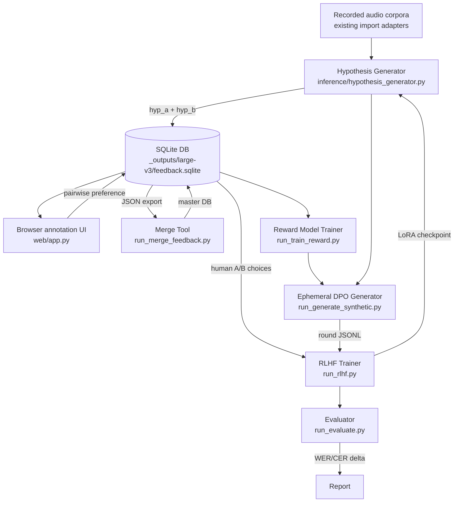

# Architecture Reference

## Pipeline Overview



---

## Module Map

```
paths.py                     PathsConfig + DEFAULT_PATHS singleton
default_paths.json           Machine-local data paths (edit once per machine)

config/
  inference_config.json      InferenceConfig defaults
  reward_model_config.json   RewardModelConfig defaults
  rlhf_config.json           RLHFConfig defaults

utils/
  log.py                     setup_logging(), get_logger()
  audio.py                   load_audio(), validate_audio_file(), get_duration()
  policy_checkpoint.py       Resolve and publish the active Whisper LoRA policy

storage/
  migrations/               Ordered schema migrations, including generic catalogue
  schema.py                  Dataclasses for assets, corpora, utterances and feedback
  feedback_store.py          All DB read/write; single connection context manager
  merger.py                  merge_exports() — multi-machine JSON merge

inference/
  decoding_strategies.py     DecodingStrategy dataclass; BEAM_5 (base config for N-best beam)
  config.py                  InferenceConfig (model, batch size, sampling temperature, dataset scope)
  hypothesis_generator.py    HypothesisGenerator: catalogue → pairs in DB

web/
  app.py                     FastAPI web annotation UI (primary, browser-based)
                             Admin Training/Evaluation corpus tabs, validated upload/preview/acceptance
  templates/                 annotate.html, admin.html, setup.html, admin_login.html
  static/                    style.css

scripts/
  coordinator.py             Background training orchestrator (Docker service)

tts/
  provider.py                Frozen-origin selection; legacy external jobs adapter
  local_provider.py          Authenticated local v0.7 jobs; bounded ZIP/provenance verification
  worker.py                  CPU web campaign dispatcher; durable jobs and validated import
  quality.py                 CPU dispatch to local ASR; persisted report-only assessment

prepare_data.py              One-time data prep: ZIP archives → manifest CSVs
run_import_corpus.py         Generic local CSV validation → inactive recorded corpus; explicit activation

reward_model/
  config.py                  RewardModelConfig (Whisper enc + BERT + MLP, training hyperparams)
  audio_text_reward.py       AudioTextRewardModel: frozen Whisper enc + Polish BERT + MLP head
  train_reward_model.py      RewardModelTrainer: Bradley-Terry pairwise loss on human preferences

rlhf/
  config.py                  RLHFConfig (algorithm, LoRA, training hyperparameters)
  preference_data.py         Human choices + validated current-round synthetic JSONL
  reward_buffer.py           Compatibility reader for persisted historical scores
  dataset.py                 WhisperRLHFDataset + WhisperRLHFCollator
  reference_model.py         ReferenceWhisper: frozen exact-precision DPO reference
  trainer.py                 WhisperRLHFTrainer: DPO (PPO stub, NotImplementedError)

evaluation/
  evaluator.py               WhisperEvaluator: frozen monitor snapshot for DPO WER/CER; legacy CSV fallback
  report.py                  generate_text_report(), generate_markdown_report()

run_generate_pairs.py        Entry: load catalogue → generate pairs
run_generate_synthetic.py    Entry: ephemeral current-round synthetic DPO JSONL
run_merge_feedback.py        Entry: export this DB / merge JSON exports
run_score_rewards.py         Compatibility/analysis scoring; not automated DPO input
run_reward_audit.py          Coordinator worker: score one diagnostic audit job
run_train_reward.py          Entry: train AudioTextRewardModel MLP head on human preferences
run_rlhf.py                  Entry: DPO fine-tuning → evaluate → record run
run_evaluate.py              Entry: standalone WER evaluation + run history report
run_evaluate_canary.py       Entry: resumable deterministic Model Evaluation backfill
```

---

## Data Flow: Annotation → Training

The root VoiceGrader `tts/` tree contains separate synthesis-engine services
and the REST API, not the RLHF client package listed above. CPU web submits
only explicit durable campaigns to their frozen provider. New campaigns default
to internal `tts-api`, which delegates to CPU Piper or a separately enabled
GPU engine. Local capabilities disable stopped/missing-asset engines, and
campaign estimates explicitly exclude texts over 280 characters. API state and
archives persist separately from the feedback database. Existing external
campaigns keep the legacy API; new local profile IDs prevent provenance mixing.
No synthesis model runs in the web/coordinator. Imported audio still passes the
shared decoder and retains zero-default independent SFT/refill caps.

```
1. Audio CSV  ──► HypothesisGenerator.load_audio_catalogue()
                    └─► AudioFile rows linked to corpus/utterance identities

   Generic CSV ──► run_import_corpus.py import
                    ├─► native duration check + shared decoder validation
                    └─► atomic inactive corpus/assets; explicit activate enables selection

2. audio_files ──► HypothesisGenerator.generate_candidates(n_candidates=6)
                    ├─► randomly samples audio eligible for the active policy
                    ├─► base Whisper + active LoRA policy adapter
                    ├─► Pass 1: Whisper beam search (num_beams=5, do_sample=False)
                    │     └─► deterministic best hypothesis
                    ├─► Pass 2: temperature sampling (t=0.8, num_return_sequences=n-1)
                    │     └─► stochastic alternatives
                    ├─► Pairing: beam result vs. highest edit-distance sample
                    └─► HypothesisPair rows inserted (status='pending')

3. hypothesis_pairs ──► Browser UI
                          ├─► loads pending pairs (with reservation window)
                          ├─► plays audio via AudioPlayer
                          └─► Annotation row inserted
                               + pair status → 'annotated' or 'skipped'

4. annotations ──► immutable AudioTextRewardModel checkpoint
        └─► human A/B choices train Bradley-Terry utility logits

5. DPO start policy ──► run_generate_synthetic.py
         ├─► randomized audio + N-best Whisper candidates
         ├─► current reward checkpoint selects best/worst
         ├─► reward-margin and token-edit filters reject weak pairs
         ├─► pool size scales from the guarded human/synthetic target
         └─► round-scoped synthetic_pairs.jsonl (not SQLite)

6. human choices + synthetic JSONL ──► WhisperRLHFTrainer.train() [DPO]
                ├─► only current-policy human choices remain authoritative
                ├─► synthetic ratio is guarded and capped at 1:1 by default
                └─► pending LoRA candidate saved

7. SFT parent + pending candidate + deployed policy ──► frozen evaluation set
                    ├─► cache intermediate SFT output for diagnosis
                    ├─► compare SFT and DPO with paired beam-5 corpus-WER bootstrap
                    ├─► CI upper bound ≤ +0.01 and lower WER: output is eligible
                    ├─► activate the lowest-WER eligible round output
                    ├─► zero changed monitor transcripts: reject as a no-op
                    ├─► otherwise retain deployed policy and candidate diagnostics
                    └─► activation retires stale pending pairs and queues refill
```

---

## Key Design Decisions

### Ephemeral synthetic preference generation
The AudioTextRewardModel and Whisper DPO training never share GPU memory. Synthetic generation first runs the exact DPO start policy, unloads it, then ranks candidates with one immutable reward checkpoint. The resulting JSONL belongs only to that round and is deleted after successful policy publication. Persistent `reward_scores` remain available for compatibility and analysis but do not drive automated DPO.

### Reward Audit isolation
The authenticated web UI selects durable hypothesis-pair IDs and queues a
`reward_audit_jobs` row. The GPU coordinator runs `run_reward_audit.py` with the
selected immutable reward checkpoint and writes utilities only to
`reward_audit_items`. Audit rows are joined with the latest human annotation for
display, but are never consumed by reward training, SFT, or DPO.

### REINFORCE before DPO before PPO
- **REINFORCE** — removed 2026-07-15; reward-weighted MLE; was too unstable on sparse preferences.
- **DPO** — active algorithm; no reward model needed at training time; better theoretical guarantees; requires clear preference signal (non-equal rewards).
- **PPO** — online rollout required; not yet implemented (`NotImplementedError`).

### UUID4 primary keys
All PKs are `uuid.uuid4()` strings. Safe cross-machine merge without coordination. Merge is pure `INSERT OR IGNORE` with logical conflict resolution (see [MULTI_MACHINE.md](MULTI_MACHINE.md)).

### LoRA-only fine-tuning
PEFT applies LoRA to every Whisper module ending in `q_proj` or `v_proj`: encoder self-attention plus decoder self-attention and cross-attention. Base weights remain frozen, but the encoder is not fully frozen because its attention projections receive trainable LoRA updates. Existing adapters depend on this scope.

GPU model loads use PyTorch SDPA attention. On CUDA, the shared runtime setup
enables TF32 matmul, cuDNN TF32, and fixed-shape convolution autotuning. SFT and
DPO use pinned host batches, non-blocking transfers, and fused AdamW when CUDA
supports it. The reward model keeps both frozen encoders in FP16 and its
trainable MLP in FP32; frozen audio/text embeddings are computed once per round
and reused across reward-training epochs. Synthetic reward scoring batches
multiple clips and their candidate texts in one encoder call.

### Active policy continuity
The DB setting `active_policy_checkpoint` names the deployed LoRA adapter. Pair generation attaches its exact model version to each pair; SFT and human DPO read only feedback from that version. DPO starts from the resulting SFT adapter (or directly from active policy when SFT is skipped). The frozen FP16 DPO reference is the same round-start adapter in deterministic evaluation mode. Successful gated activation retires only stale pending pairs, never annotated history.

Internal deployment and external distribution have separate pointers. After a
deployed policy has a completed healthy monitor evaluation, an admin can
explicitly publish it to `latest_model_dir`. The CPU-only web service copies the
LoRA checkpoint into a sibling staging directory, writes checksummed provenance
to `publication.json`, and swaps the directory while retaining the previous
export until the new directory is in place. Downstream applications consume
this configured stable path instead of scanning `_outputs/checkpoints/`.

The prospective model evaluation set is stored separately and excluded from all learning
queries. Freezing it requests GPU evaluation, and every DPO candidate must pass
a blocking paired beam-5 comparison against the deployed policy before publication. The profile hash binds decode
settings to the locked transcript fingerprint. Unlocking creates a named draft
revision; editing or rerolling a faulty clip therefore cannot mutate historical
predictions. Locking that revision creates a new cache generation. Versioned
per-clip predictions and aggregate accuracy and formatting metrics are cached
in SQLite. The CPU-only admin dashboard reads those records and uses the shared
audited policy helper for rollback.

### Continuous annotation
No fixed batch size. Annotators start a session, annotate freely, and close the window at any time. The DB is the source of truth; the GUI queue is ephemeral RAM. Background refill randomly selects policy-eligible audio when the queue drops below threshold; annotators receive generated pairs oldest-first within that randomized queue.

### ASR reload and synthesized-audio quality

The CPU web lifespan runs the persisted TTS campaign dispatcher for external
submission, polling and validated audio import. It uses the existing leased,
restart-safe worker in a background thread, without loading synthesis models or
launching ML subprocesses. The GPU coordinator does not own campaign processing;
stopping it for ASR quality review does not stall synthesis campaigns.

ASR owns an admission/drain controller for file HTTP/SSE requests, live sessions
and outstanding worker tasks. Publication polling or an authenticated reload
request drains work, restarts workers on the verified publication and reports
readiness before changing its loaded identity. Failed activation restores the
prior pointer/runtime; failed restoration keeps admissions unavailable.

Migration 010 persists on-demand synthesized-audio quality requests and human
review notes. A CPU-only web HTTP dispatcher submits normalized WAVs to the local
ASR `/api/quality` endpoint, which reuses its existing SNR and WhiSQA workers
without transcription. This remains usable while the GPU training coordinator
is stopped. Scores are informational and never change learning eligibility.
